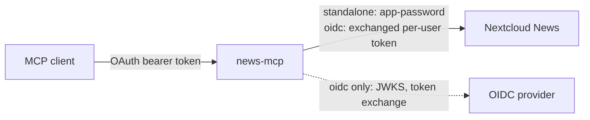

# mcp-nextcloud-news

An [MCP](https://modelcontextprotocol.io) server, written in Go, that exposes a [Nextcloud News](https://apps.nextcloud.com/apps/news) account to MCP clients (Claude Code, Claude Desktop, Cursor, …). It lets them browse feeds and articles, read full text, and manage read / unread and starred state.

- **Transport.** Streamable HTTP on `/mcp`.
- **Two authentication modes**, both following the [MCP authorization spec](https://modelcontextprotocol.io/specification/latest/basic/authorization):
  - **`standalone` (default).** No identity provider is needed. news-mcp embeds a small OAuth 2.1 server and calls Nextcloud with an app-password that never leaves the server.
  - **`oidc`.** An external OpenID Connect provider (Keycloak, …) issues the tokens. news-mcp validates them and obtains a separate Nextcloud token per user through token exchange.
- **Small footprint.** A single static binary (~11 MB) using ~15 MB of RAM, built from the standard library plus the official [Go MCP SDK](https://github.com/modelcontextprotocol/go-sdk).



**Real-world use.** I run news-mcp in [OIDC mode](docs/oidc.md#behind-an-mcp-gateway) behind [agentgateway](https://agentgateway.dev), with Keycloak as the identity provider. My AI agent uses it to read the unread RSS articles, write a summary of them, and mark them as read.

## Quick start

Run news-mcp in standalone mode:

```sh
export NEXTCLOUD_URL=https://cloud.example.com
export NEXTCLOUD_USER='your-user'
export NEXTCLOUD_APP_PASSWORD='xxxxx-xxxxx-xxxxx-xxxxx-xxxxx'   # Nextcloud: Settings → Security
export MCP_AUTH_PASSWORD='a long passphrase'                    # typed when a client asks for access
go run github.com/mrdev023/mcp-nextcloud-news@latest
```

Then connect a client, for example Claude Code:

```sh
claude mcp add --transport http nextcloud-news http://localhost:8080/mcp
# then in Claude Code: /mcp → nextcloud-news → Authenticate
```

Or with Docker. Multi-arch images are published on GHCR; they are distroless, run as non-root and are about 5 MB compressed:

```sh
docker run -d -p 8080:8080 \
  -e NEXTCLOUD_URL=https://cloud.example.com -e NEXTCLOUD_USER='your-user' \
  -e NEXTCLOUD_APP_PASSWORD='xxxxx-xxxxx-xxxxx-xxxxx-xxxxx' -e MCP_AUTH_PASSWORD='a long passphrase' \
  ghcr.io/mrdev023/mcp-nextcloud-news:latest
```

## Documentation

| Guide | |
|---|---|
| [Standalone mode](docs/standalone.md) | App-password setup, Docker Compose, reverse proxy, client configuration, OAuth flow |
| [OIDC mode](docs/oidc.md) | External identity provider, token validation and exchange, direct or gateway deployments |
| [Keycloak example](docs/keycloak.md) | Clients, audience mappers and Nextcloud `user_oidc` settings, step by step |
| [Configuration reference](docs/configuration.md) | Every environment variable and HTTP endpoint |
| [Architecture](docs/architecture.md) | Code layout, request lifecycle, design choices, tests, build |
| [Troubleshooting](docs/troubleshooting.md) | Common errors and their fixes |

## Tools

| Tool | What it does | Hints |
|---|---|---|
| `news_list_feeds` | Feeds (id, title, url, folder, unread count) and folders | read-only |
| `news_list_items` | Articles, unread only by default. Filters: `feedId`, `folderId`, `starredOnly`, `includeRead`, `search`; paging: `limit` (≤ 100), `offset`, `oldestFirst`; `includeBody` | read-only |
| `news_get_item` | One article: title, url, author, body (`format` `text` or `html`, `maxBodyChars`) | read-only |
| `news_mark_read` | Mark `itemId` or `itemIds[]` as read | destructive |
| `news_mark_unread` | Mark `itemId` or `itemIds[]` as unread | destructive |
| `news_mark_all_read` | Mark everything read up to `newestItemId` (default: the newest article) | destructive |
| `news_star` / `news_unstar` | Star / unstar an article (`id`) | destructive |
| `news_get_updated` | Incremental sync since `lastModified`; returns `nextLastModified` | read-only |

- **Pagination.** In the News API, `offset` is an **article id**, not a count. Pass back the `nextOffset` returned by the previous page; `nextOffset: 0` means there are no more pages.
- **Bodies.** List tools return a 280-character excerpt, or the body truncated to 2,000 characters with `includeBody`. `news_get_item` returns plain text truncated to 20,000 characters by default.

## Development

```sh
go test ./...
CGO_ENABLED=0 go build -trimpath -ldflags="-s -w" -o news-mcp .
```

An optional Nix shell (`shell.nix`) provides Go and gopls; with direnv, run `direnv allow`. See [Architecture](docs/architecture.md) for how the code is organised.

## Need more than News?

This project deliberately does one thing: Nextcloud News, in a small Go binary. If you want an MCP server for the rest of your Nextcloud, have a look at **[cbcoutinho/nextcloud-mcp-server](https://github.com/cbcoutinho/nextcloud-mcp-server)**. It is an excellent, much more complete project, covering:

- Notes, Calendar, Contacts, Files, Deck, Tables, Cookbook and News, among other apps;
- multi-user authentication;
- optional semantic search.

Many thanks to its author; it was a great reference while building this one.

## License

[MIT](LICENSE)
