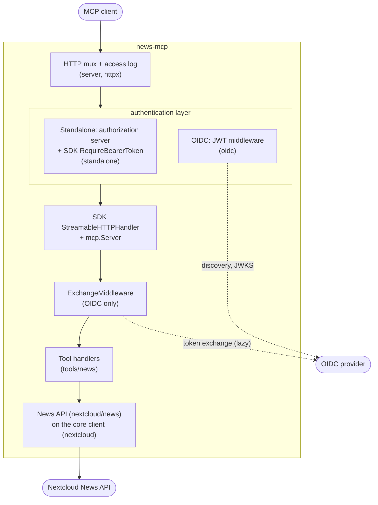
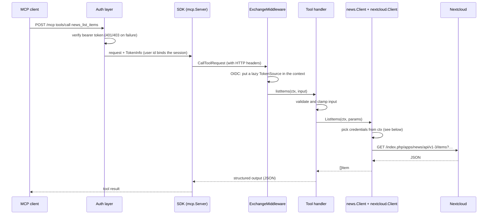
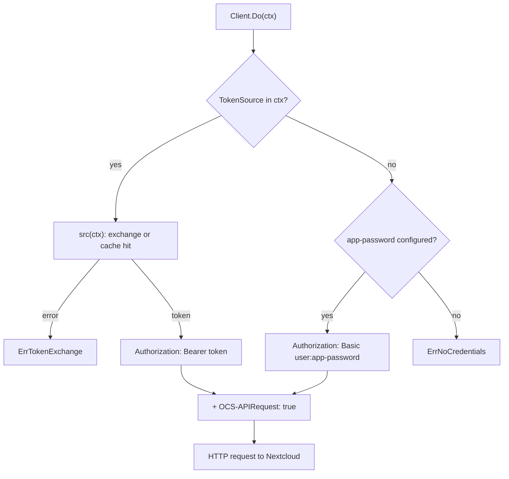

# Architecture

news-mcp is a Go module of about 2,800 lines (plus tests): one binary, no database, no background workers. Following the usual layout of Go MCP servers, `cmd/` holds the entry point and `internal/` one package per concern. This page explains how it is organised and why.

## Repository layout

| Path | Contents |
|---|---|
| `cmd/mcp-nextcloud` | Entry point (`run`): configuration, HTTP server, signals and graceful shutdown, memory limit, `version` |
| `internal/config` | Configuration loading and validation from the environment (`config.Load`) |
| `internal/server` | HTTP routing (`server.NewHandler`): MCP server, authentication layer, discovery documents |
| `internal/nextcloud` | Core Nextcloud client shared by every app module (`Client.Do`): credential selection, request building, response size limit, 401/404/error mapping |
| `internal/nextcloud/news` | News API v1-3 on top of the core client: types, one method per endpoint |
| `internal/tools` | Core of the MCP tools: registry (`Toolset`, `New`, `Register`), effects and the annotations derived from them, read-only filter, shared error messages (`MapErr`) |
| `internal/tools/news` | The nine `news_*` tools: input/output types, validation, HTML-to-text and truncation helpers |
| `internal/standalone` | Standalone mode: the embedded OAuth 2.1 authorization server (metadata, `/register`, `/authorize`, `/token`, token verification) |
| `internal/oidc` | OIDC mode: JWT validation with go-oidc behind a rate-limited JWKS cache, 401/403 middleware, RFC 8693 token exchange with cache |
| `internal/httpx` | Small HTTP helpers: bearer token parsing, access log, loopback check |
| `internal/nextcloud/nextcloudtest`, `internal/oidc/oidctest` | In-process fake Nextcloud app API and fake identity provider, shared by the tests |
| `docs/` | This documentation |
| `Dockerfile`, `.dockerignore` | Multi-stage, cross-compiling image build on `distroless/static` |
| `.github/workflows/ci.yml` | GitHub: tests, then multi-arch image to GHCR |
| `.forgejo/workflows/deploy.yml` | Forgejo mirror: tests, then image to the Forgejo registry |
| `shell.nix`, `npins/`, `.envrc` | Optional Nix development shell (Go, gopls), loaded by direnv |

## Components



`server.NewHandler` assembles this chain once at startup. Exactly one of the two authentication layers is mounted, depending on `MCP_AUTH_MODE`. The MCP protocol itself (sessions, JSON-RPC, SSE, tool schemas) is handled by the official [Go MCP SDK](https://github.com/modelcontextprotocol/go-sdk).

## Life of a tool call



Errors flow back through `tools.MapErr`, shared by every module, which turns client errors into short, actionable messages: wrong credentials, item not found, token exchange refused, timeout. Raw responses are never echoed.

### Credential selection

`nextcloud.Client` is the one transport of every app module and holds no per-user state. Each call decides how to authenticate from its `context.Context`:



Because credentials travel in the request context, a token can never leak from one user's request into another's.

## Adding a Nextcloud app

Each app is a module in two packages; authentication, transport and the tool registry are shared:

1. **API client** in `internal/nextcloud/<app>`: an `APIPath` constant, the app's types, and a `Client` wrapping `*nextcloud.Client` whose methods call `Do` with paths below `APIPath`. Test it against `nextcloudtest.NewServer(t, APIPath, routes)`.
2. **Tools** in `internal/tools/<app>`: an `API` interface listing the client methods the tools use, the handlers, and a `Toolset(api)` function declaring each tool with `tools.New` and its effect (`tools.ReadOnly`, `tools.Reversible` or `tools.Destructive`). Wrap client errors with `tools.MapErr`.
3. **Wiring**: add `<app>tools.Toolset(<app>.New(nc))` to the `tools.Register` call in `internal/server`.

`MCP_READ_ONLY` and the annotations then apply to the new tools with no extra code. Each module keeps its own schema snapshots.

## Design choices

- **Stateless standalone tokens.** Authorization codes, access and refresh tokens, and DCR client ids are self-contained blobs signed with HMAC-SHA256. Nothing is stored except the ids of redeemed codes (until they expire), so tokens survive restarts. Rotating the signing key revokes everything.
- **No token passthrough.** In OIDC mode the incoming token is validated for news-mcp's own audience, and Nextcloud only ever sees a token obtained by token exchange (see [OIDC mode](oidc.md)).
- **Lazy, cached exchange.** Listing tools without calling Nextcloud costs no exchange. Exchanged tokens are cached per incoming token (keyed by its SHA-256) in a bounded map of 256 entries, and never outlive the incoming token.
- **Small memory footprint.**
  - The Go heap gets a soft limit of 32 MiB (`GOMEMLIMIT`).
  - Nextcloud and identity provider responses are size-capped (16 MiB and 1 MiB).
  - The HTTP connection pool is small.
  - Idle MCP sessions expire after 30 minutes.
  - Typical RSS is around 15 MB.
- **Few dependencies.** The standard library, the MCP SDK, and in OIDC mode `coreos/go-oidc` with `go-jose` for token verification, rather than hand-written JWK and signature code. HTML-to-text conversion uses a few regular expressions instead of an HTML parser.
- **Secrets stay out of logs.** The access log records method, path, status and duration, never headers. Token exchange errors log only the provider's `error` / `error_description`.

## News API specifics

The News API has a few quirks the client hides:

- **`offset` is an article id, not a count.** The tools return a `nextOffset` cursor to pass back.
- **No single-item endpoint.** `GetItem(id)` asks for one item of type "all" with `offset = id + 1`, then checks the id.
- **Two field spellings.** Item fields have been named both `unread`/`starred` and `isUnread`/`isStarred` across versions; both are accepted.
- **Bearer tokens need `OCS-APIRequest: true`.** The routes are CORS-enabled, and without this header Nextcloud demands Basic auth.

## Testing

```sh
go vet ./...
golangci-lint run ./...   # config in .golangci.yml
go test ./...
```

| Package | Covers |
|---|---|
| `internal/nextcloud` | Credential selection from the context (token source, app-password, none) |
| `internal/nextcloud/news` | Every News method against a fake Nextcloud (`nextcloudtest`): query strings, request bodies, 401/404/500 mapping, no password in errors |
| `internal/tools` | Registry: read-only filter, annotations derived from effects; shared error messages |
| `internal/tools/news` | Every tool through an in-memory MCP session and a fake client: parameters, validation, paging, error messages, annotations; schema snapshots in `testdata/toolsnaps` |
| `internal/standalone` | Standalone end to end: registration, consent, PKCE, code replay, refresh, MCP session with tool calls; resource matching |
| `internal/oidc` | JWT acceptance and rejection (audience, issuer, signature, expiry, `none`/HS256), key rotation, JWKS refresh rate limit, discovery issuer mismatch, token exchange and its bounded cache |
| `internal/config` | Configuration validation for both authentication modes |
| `internal/server` | Discovery routes and consent page; OIDC end to end with two users through the real handler, no secrets in logs |
| `internal/httpx` | Bearer token parsing |

All tests run in-process in well under a second, without network access.

The JSON schemas the tools expose are pinned by snapshots. After an intended change to a tool (description, input or output struct tags), regenerate them and review the diff:

```sh
go test ./internal/tools/news -run TestToolSnapshots -update
```

## Build and release

- **Binary.** `CGO_ENABLED=0 go build -trimpath -ldflags="-s -w -X main.version=…" ./cmd/mcp-nextcloud` produces a static binary of about 11 MB.
- **Image.** The `Dockerfile` builds on the native platform and cross-compiles with `GOOS`/`GOARCH`, so multi-arch images need no emulation. The final stage is `gcr.io/distroless/static-debian12:nonroot`.
- **CI.**
  - GitHub Actions runs gofmt, vet, golangci-lint, tests and a build on every push and pull request.
  - It publishes `ghcr.io/<owner>/mcp-nextcloud-news` (`latest`, semver tags, sha) for `linux/amd64` and `linux/arm64`.
  - A separate Forgejo workflow publishes to a self-hosted registry.
- **Development shell.** `shell.nix` (nixpkgs pinned by npins) provides Go, gopls and golangci-lint with `CGO_ENABLED=0`; `direnv allow` loads it automatically.
