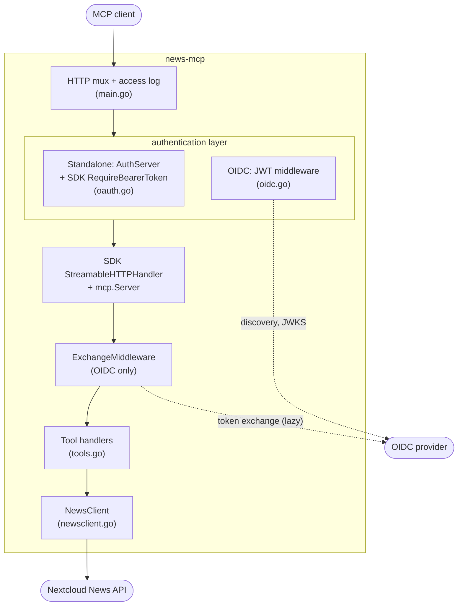
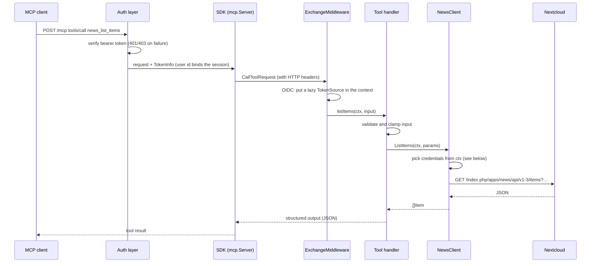
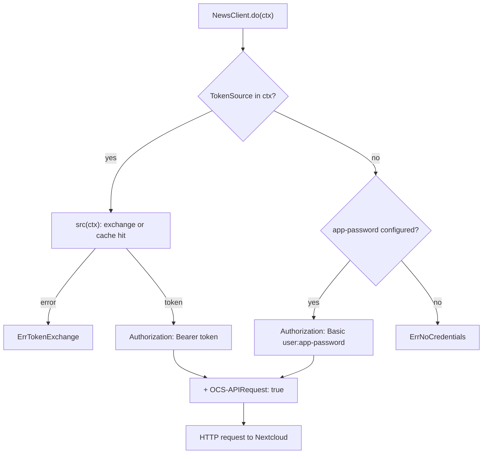

# Architecture

news-mcp is a single Go `main` package of about 2,500 lines (plus tests): one binary, no database, no background workers. This page explains how it is organised and why.

## Repository layout

| Path | Contents |
|---|---|
| `main.go` | Configuration loading (`loadConfig`), HTTP routing (`buildHandler`), server startup and shutdown (`run`), access log |
| `tools.go` | The nine MCP tools: input/output types, validation, error mapping (`mapErr`), HTML-to-text and truncation helpers |
| `newsclient.go` | Nextcloud News API v1-3 client: one method per endpoint, credential selection, response size limit |
| `oauth.go` | Standalone mode: the embedded OAuth 2.1 authorization server (metadata, `/register`, `/authorize`, `/token`, token verification) |
| `oidc.go` | OIDC mode: discovery, JWKS cache, JWT validation middleware, RFC 8693 token exchange with cache |
| `*_test.go` | Unit and end-to-end tests against in-process fake Nextcloud and fake identity provider servers |
| `docs/` | This documentation |
| `Dockerfile`, `.dockerignore` | Multi-stage, cross-compiling image build on `distroless/static` |
| `.github/workflows/ci.yml` | GitHub: tests, then multi-arch image to GHCR |
| `.forgejo/workflows/deploy.yml` | Forgejo mirror: tests, then image to the Forgejo registry |
| `shell.nix`, `npins/`, `.envrc` | Optional Nix development shell (Go, gopls), loaded by direnv |

## Components



`buildHandler` assembles this chain once at startup. Exactly one of the two authentication layers is mounted, depending on `MCP_AUTH_MODE`. The MCP protocol itself (sessions, JSON-RPC, SSE, tool schemas) is handled by the official [Go MCP SDK](https://github.com/modelcontextprotocol/go-sdk).

## Life of a tool call



Errors flow back through `mapErr`, which turns client errors into short, actionable messages: wrong credentials, item not found, token exchange refused, timeout. Raw responses are never echoed.

### Credential selection

`NewsClient` holds no per-user state. Each call decides how to authenticate from its `context.Context`:



Because credentials travel in the request context, a token can never leak from one user's request into another's.

## Design choices

- **Stateless standalone tokens.** Authorization codes, access and refresh tokens, and DCR client ids are self-contained blobs signed with HMAC-SHA256. Nothing is stored except the ids of redeemed codes (until they expire), so tokens survive restarts. Rotating the signing key revokes everything.
- **No token passthrough.** In OIDC mode the incoming token is validated for news-mcp's own audience, and Nextcloud only ever sees a token obtained by token exchange (see [OIDC mode](oidc.md)).
- **Lazy, cached exchange.** Listing tools without calling Nextcloud costs no exchange. Exchanged tokens are cached per incoming token (keyed by its SHA-256) in a bounded map of 256 entries, and never outlive the incoming token.
- **Small memory footprint.**
  - The Go heap gets a soft limit of 32 MiB (`GOMEMLIMIT`).
  - Nextcloud and identity provider responses are size-capped (16 MiB and 1 MiB).
  - The HTTP connection pool is small.
  - Idle MCP sessions expire after 30 minutes.
  - Typical RSS is around 15 MB.
- **Few dependencies.** Only the standard library, the MCP SDK and `golang-jwt/jwt` (already a dependency of the SDK). HTML-to-text conversion uses a few regular expressions instead of an HTML parser.
- **Secrets stay out of logs.** The access log records method, path, status and duration, never headers. Token exchange errors log only the provider's `error` / `error_description`.

## News API specifics

The News API has a few quirks the client hides:

- **`offset` is an article id, not a count.** The tools return a `nextOffset` cursor to pass back.
- **No single-item endpoint.** `GetItem(id)` asks for one item of type "all" with `offset = id + 1`, then checks the id.
- **Two field spellings.** Item fields have been named both `unread`/`starred` and `isUnread`/`isStarred` across versions; both are accepted.
- **Bearer tokens need `OCS-APIRequest: true`.** The routes are CORS-enabled, and without this header Nextcloud demands Basic auth.

## Testing

```sh
go vet ./...
go test ./...
```

| Test file | Covers |
|---|---|
| `newsclient_test.go` | Every client method against a fake Nextcloud (`httptest`): query strings, request bodies, 401/404/500 mapping, no password in errors |
| `oauth_test.go` | Standalone end to end: registration, consent page, PKCE, code replay, refresh, MCP session, discovery routes, resource matching |
| `oidc_test.go` | OIDC: configuration validation, JWT acceptance and rejection (audience, issuer, signature, expiry, `none`/HS256), key rotation, token exchange and its cache, end-to-end with two users, no secrets in logs |

All tests run in-process in well under a second, without network access.

## Build and release

- **Binary.** `CGO_ENABLED=0 go build -trimpath -ldflags="-s -w -X main.version=…"` produces a static binary of about 11 MB.
- **Image.** The `Dockerfile` builds on the native platform and cross-compiles with `GOOS`/`GOARCH`, so multi-arch images need no emulation. The final stage is `gcr.io/distroless/static-debian12:nonroot`.
- **CI.**
  - GitHub Actions runs gofmt, vet, tests and a build on every push and pull request.
  - It publishes `ghcr.io/<owner>/mcp-nextcloud-news` (`latest`, semver tags, sha) for `linux/amd64` and `linux/arm64`.
  - A separate Forgejo workflow publishes to a self-hosted registry.
- **Development shell.** `shell.nix` (nixpkgs pinned by npins) provides Go and gopls with `CGO_ENABLED=0`; `direnv allow` loads it automatically.
