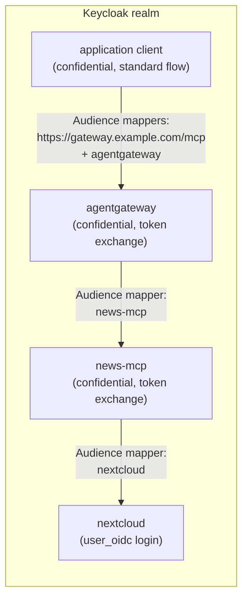
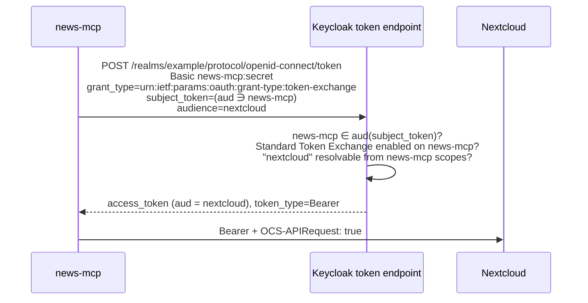

# Keycloak example

This guide sets up [OIDC mode](oidc.md) with Keycloak. It assumes:

- **Keycloak 26.2 or later.** Standard Token Exchange (V2) is enabled by default from that version on, so no server feature flag is needed: only a per-client switch.
- **A realm `example`, reachable at `https://id.example.com`.** The issuer is then `https://id.example.com/realms/example`.
- **Nextcloud already signs users in with Keycloak** through the [`user_oidc`](https://github.com/nextcloud/user_oidc) app, using a Keycloak client named `nextcloud`.

Instructions refer to the Keycloak admin console.

## Overview

| Keycloak client | Type | Role |
|---|---|---|
| `nextcloud` | confidential | Already exists for Nextcloud login. Exchanged tokens must carry it in `aud`. |
| `news-mcp` | confidential | news-mcp's own client: performs the token exchange towards `nextcloud`. |
| Your caller | depends | Whatever gives news-mcp its tokens: an MCP gateway's client, or the client an MCP application uses. Its tokens must carry `news-mcp` in `aud`. |

How the clients and audience mappers fit together (gateway setup):



Each arrow reads: tokens obtained by the client on the left contain the audience on the right, which is what lets that next client accept them and exchange them.

The exchange news-mcp performs:



Two Keycloak rules shape the setup:

1. **The requesting client must be an audience of the subject token.** news-mcp can only exchange tokens whose `aud` contains `news-mcp`. This is the same check news-mcp applies with `MCP_OIDC_AUDIENCE=news-mcp`.
2. **The `audience` parameter filters, it does not add.** Keycloak only grants `audience=nextcloud` if the `news-mcp` client's own scopes already resolve `nextcloud` as an audience. Otherwise it answers *"Requested audience not available"*.

## 1. Nextcloud accepts bearer tokens

Enable bearer validation on the existing `user_oidc` provider:

```sh
occ user_oidc:provider Keycloak --check-bearer=1
# verify
occ user_oidc:provider Keycloak --output=json   # "checkBearer": true
```

Things to know:

- **Users must have signed in once.** With bearer provisioning off (the default), a user must have signed in to Nextcloud through Keycloak at least once, otherwise their tokens are refused. `--bearer-provisioning=1` creates accounts on first bearer use instead.
- **Same user as the login.** The exchanged token keeps the user's `sub`, so with the default unique-uid setting it maps to the same Nextcloud account as the browser login.
- **Private network.** If Keycloak resolves to a private IP from Nextcloud, set `'allow_local_remote_servers' => true` in `config.php`.

## 2. Create the `news-mcp` client

**Clients → Create client**:

1. **General settings:**
   - *Client type*: OpenID Connect.
   - *Client ID*: `news-mcp`.
2. **Capability config:**
   - *Client authentication*: **On** (confidential client).
   - *Standard flow*: Off.
   - *Direct access grants*: Off.
   - **Standard Token Exchange**: **On**. This switch sits right next to *Direct access grants* and is easy to untick by mistake.
3. **Login settings:** leave every redirect URI empty.

Then:

- **Credentials** tab: copy the *Client secret* into `MCP_OIDC_CLIENT_SECRET`.
- **Client scopes** tab → **news-mcp-dedicated** → *Configure a new mapper* → **Audience**:
  - *Name*: `audience nextcloud`
  - *Included Client Audience*: `nextcloud`
  - *Add to access token*: On

This mapper is what makes `audience=nextcloud` available to news-mcp in the exchange.

## 3. Give news-mcp tokens to the caller

Whatever calls news-mcp must present tokens whose `aud` contains `news-mcp`.

### a) Behind an MCP gateway (tested setup)

Example with [agentgateway](https://agentgateway.dev), which validates tokens for its own URL and exchanges them for news-mcp. Two clients are involved.

**The application client** that signs users in and calls the gateway (for instance a chat front-end): it is a confidential client with standard flow. Its tokens must contain both the gateway's resource URI and the gateway's client id. Add **two** Audience mappers on its dedicated scope:

| Mapper | Field | Value |
|---|---|---|
| `audience gateway url` | *Included Custom Audience* | `https://gateway.example.com/mcp` |
| `audience gateway client` | *Included Client Audience* | `agentgateway` |

> **Pitfall:** one Audience mapper produces a single value. When *Included Client Audience* is set, *Included Custom Audience* is ignored, hence two mappers.

**The gateway client `agentgateway`:**

- *Client authentication*: On.
- **Standard Token Exchange**: On.
- *Direct access grants*: Off.
- Dedicated scope: an **Audience** mapper with *Included Client Audience* `news-mcp`.

Then point the gateway's token exchange at `audiences: [news-mcp]`. See the agentgateway excerpt in [OIDC mode](oidc.md#behind-an-mcp-gateway).

### b) MCP clients connecting directly (untested)

Give the client used by the MCP application an **Audience** mapper with *Included Client Audience* `news-mcp`, and set `MCP_OIDC_AUDIENCE=news-mcp`.

The MCP client also needs a way to register with Keycloak, for example a pre-registered *public* client with PKCE and the application's redirect URI. Keycloak ignores the RFC 8707 `resource` parameter when building `aud`, which is why the mapper is required.

## 4. Configure news-mcp

```sh
MCP_AUTH_MODE=oidc
NEXTCLOUD_URL=https://cloud.example.com
MCP_OIDC_ISSUER=https://id.example.com/realms/example
MCP_OIDC_AUDIENCE=news-mcp
MCP_OIDC_CLIENT_ID=news-mcp
MCP_OIDC_CLIENT_SECRET=<secret from step 2>
MCP_OIDC_EXCHANGE_AUDIENCE=nextcloud
```

## 5. Verify

**Inspect token contents without real tokens.** Use **Clients → *your caller* → Client scopes → Evaluate**, pick a user and generate an example access token. Its `aud` must contain `news-mcp`. Do the same on `news-mcp`: `nextcloud` must appear.

**Run the exchange by hand**, with `$TOKEN` an access token of the caller:

```sh
curl -s -u "news-mcp:$NEWS_MCP_SECRET" \
  https://id.example.com/realms/example/protocol/openid-connect/token \
  -d grant_type=urn:ietf:params:oauth:grant-type:token-exchange \
  -d subject_token="$TOKEN" \
  -d subject_token_type=urn:ietf:params:oauth:token-type:access_token \
  -d audience=nextcloud
# -> {"access_token":"…","token_type":"Bearer","issued_token_type":"urn:ietf:params:oauth:token-type:access_token",…}
```

**Call Nextcloud** with the `access_token` from the answer:

```sh
curl -H "Authorization: Bearer $NC_TOKEN" -H "OCS-APIRequest: true" \
  https://cloud.example.com/index.php/apps/news/api/v1-3/feeds
```

A `200` with your feeds means the whole chain works. For the errors you may hit on the way, see [Troubleshooting](troubleshooting.md).
