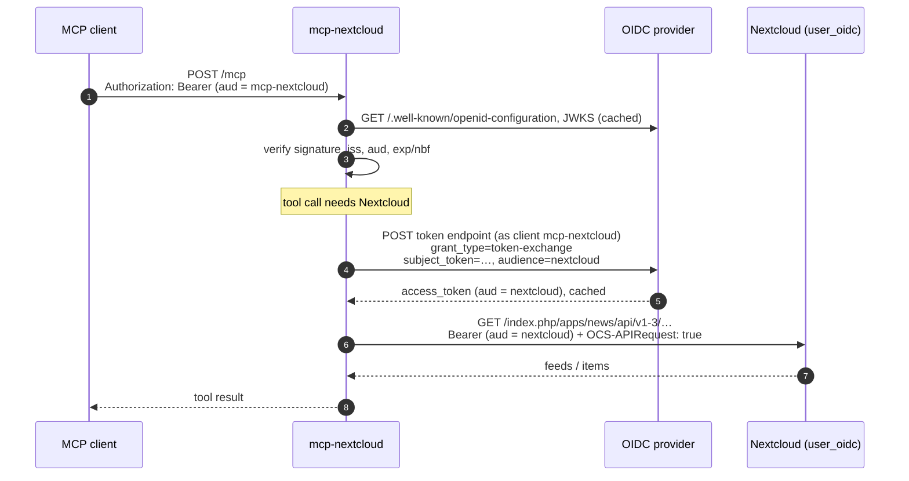
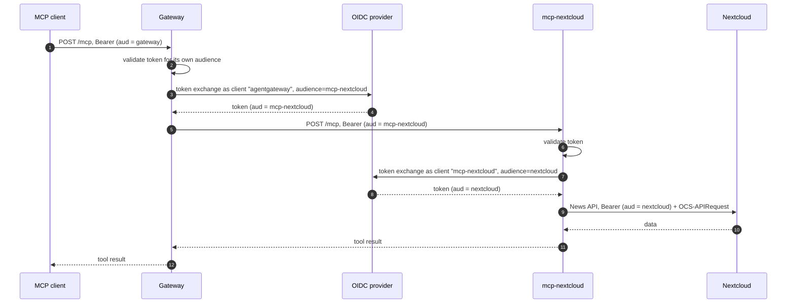
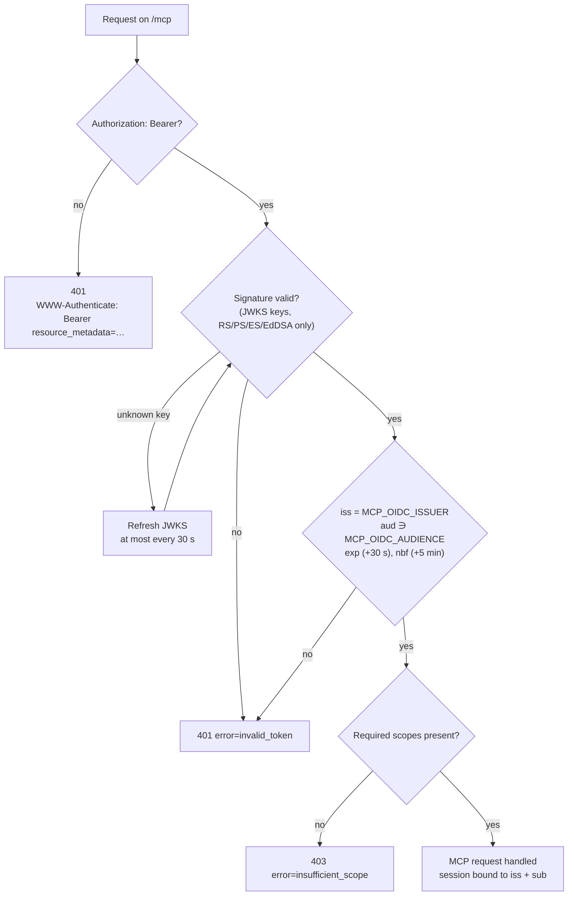

# OIDC mode

In OIDC mode an external OpenID Connect provider (Keycloak, Authentik, Zitadel, …) issues the access tokens, and Nextcloud trusts that same provider. Each user reaches Nextcloud with their own identity. mcp-nextcloud holds no user credentials.



This follows the MCP authorization spec:

- **Only tokens issued for mcp-nextcloud are accepted.** Tokens for any other audience are refused, including a token meant for Nextcloud.
- **The token received is never forwarded.** mcp-nextcloud acts as an OAuth client and obtains a distinct token for Nextcloud.
- **Discovery points to your provider.** The Protected Resource Metadata at `/.well-known/oauth-protected-resource/mcp` lists the provider as the authorization server, and mcp-nextcloud mounts no authorization endpoints.

## Requirements

- **The provider** must support:
  - OIDC discovery at `<issuer>/.well-known/openid-configuration`;
  - JWT access tokens signed with an asymmetric key (RS\*, PS\*, ES\* or EdDSA);
  - RFC 8693 token exchange.
- **Nextcloud** must accept bearer tokens from that provider, for example with the [`user_oidc`](https://github.com/nextcloud/user_oidc) app and bearer checking enabled.
- **A confidential client for mcp-nextcloud** at the provider, allowed to perform token exchange and to request the Nextcloud audience.

The [Keycloak guide](keycloak.md) covers all of this step by step.

## Configuration

```sh
MCP_AUTH_MODE=oidc
NEXTCLOUD_URL=https://cloud.example.com
MCP_BASE_URL=https://mcp.example.com                     # public URL of mcp-nextcloud
MCP_OIDC_ISSUER=https://id.example.com/realms/example
MCP_OIDC_AUDIENCE=mcp-nextcloud                                # aud that incoming tokens must contain
MCP_OIDC_CLIENT_ID=mcp-nextcloud
MCP_OIDC_CLIENT_SECRET=change-me
MCP_OIDC_EXCHANGE_AUDIENCE=nextcloud                      # client id Nextcloud validates tokens for
# MCP_OIDC_REQUIRED_SCOPES=news                           # optional
# MCP_OIDC_EXCHANGE_SCOPE=openid                          # optional
```

| Setting | Notes |
|---|---|
| `MCP_OIDC_ISSUER` | Must equal the `issuer` of the discovery document, character for character (no trailing slash for Keycloak). Must use HTTPS; plain HTTP is only allowed on loopback. |
| `MCP_OIDC_AUDIENCE` | Defaults to the resource URI `$MCP_BASE_URL/mcp`. Keycloak puts client ids in `aud`, so set it to the mcp-nextcloud client id there. |
| `MCP_OIDC_EXCHANGE_AUDIENCE` | The audience Nextcloud checks: with `user_oidc`, the client id configured in the provider. |
| `MCP_OIDC_REQUIRED_SCOPES` | Optional extra check on top of the audience. It is also advertised in the metadata. |

`NEXTCLOUD_USER`, `NEXTCLOUD_APP_PASSWORD` and `MCP_AUTH_PASSWORD` are not used in this mode.

## Deployment examples

### Exposed directly to MCP clients

```yaml
# compose.yaml
services:
  mcp-nextcloud:
    image: ghcr.io/mrdev023/mcp-nextcloud:latest
    restart: unless-stopped
    ports: ["127.0.0.1:8080:8080"]   # behind an HTTPS reverse proxy
    env_file: mcp-nextcloud.env           # the settings above, including the client secret
```

MCP clients find the provider through the metadata. They then run the provider's authorization flow and must end up with tokens whose `aud` contains `MCP_OIDC_AUDIENCE`. With Keycloak, this requires:

- **An audience mapper.** Keycloak does not derive `aud` from the RFC 8707 `resource` parameter, so the client the MCP client uses needs an audience mapper.
- **A registration method the MCP client supports.** Use a pre-registered public client with PKCE, or Keycloak's client registration.

> This direct setup works per the spec but has not been tested with a real MCP client against Keycloak. The gateway setup below is the one in use.

### Behind an MCP gateway

A gateway such as [agentgateway](https://agentgateway.dev) can authenticate users for several MCP servers at once. It validates the client's token for its own audience, then exchanges it for a mcp-nextcloud token. mcp-nextcloud validates that token and exchanges it again for Nextcloud:



Each hop receives a token issued for itself, and no component forwards the token it received.

This is the setup I use daily: an AI agent reads the unread RSS articles through the gateway, summarises them and marks them as read.

agentgateway example (excerpt):

```yaml
mcp:
  policies:
    jwtAuth:
      mode: strict
      issuer: https://id.example.com/realms/example
      audiences: [https://gateway.example.com/mcp]
      jwks: { url: https://id.example.com/realms/example/protocol/openid-connect/certs }
      preserveToken: true        # keep the token so it can be exchanged
  targets:
    - name: nextcloud
      mcp: { host: http://127.0.0.1:8080/mcp }
      policies:
        backendAuth:
          oauthTokenExchange:
            host: id.example.com:443
            policies: { backendTLS: {} }   # port 443 alone does not enable TLS
            path: /realms/example/protocol/openid-connect/token
            clientAuth: { clientId: agentgateway, clientSecret: $GATEWAY_CLIENT_SECRET, method: clientSecretBasic }
            audiences: [mcp-nextcloud]
```

- **`preserveToken: true`** is required. Without it the gateway strips the token after validating it, and the exchange fails with *"subject token missing"*. As a consequence, every *other* target must remove the `Authorization` header itself, or the user's token leaks to them.
- **Network.** mcp-nextcloud can run in the gateway's network namespace (`docker run --network=container:<gateway>`), so that only the gateway reaches it on `127.0.0.1`.

## How tokens are validated



- **Library.** Discovery and token verification use [go-oidc](https://github.com/coreos/go-oidc), and JWKS parsing uses go-jose.
- **Keys.** The JWKS is cached and refreshed every hour. A token signed with an unknown key triggers a refresh, so key rotation works without a restart. Refreshes are limited to one every 30 s, so forged tokens cannot make mcp-nextcloud flood the identity provider (go-oidc's own key set would refetch on every one).
- **Algorithms.** Only asymmetric algorithms are accepted; `none` and `HS*` are always refused.
- **Claims.** `exp` is mandatory. Clock skew is tolerated up to 30 s on `exp` and, as go-oidc does, up to 5 minutes on `nbf`.
- **No shared account.** `NEXTCLOUD_USER` / `NEXTCLOUD_APP_PASSWORD` are ignored, so there is no shared account to fall back on.

## How the exchange behaves

- **Lazy.** The exchange runs only when a tool actually calls Nextcloud, at most once per incoming token.
- **Request.** mcp-nextcloud authenticates with `client_secret_basic` and sends:
  - `subject_token_type` and `requested_token_type`: both `urn:ietf:params:oauth:token-type:access_token`;
  - `audience`: `MCP_OIDC_EXCHANGE_AUDIENCE`;
  - `scope`: `MCP_OIDC_EXCHANGE_SCOPE`, if set.
- **Response checks.** A missing `token_type` is tolerated. `N_A` is refused, because it means the result is not an access token.
- **Cache.** The exchanged token is cached until its own expiry or the incoming token's (whichever comes first), minus 30 s. The cache holds at most 256 entries.
- **Nextcloud calls.** Requests carry `Authorization: Bearer <exchanged token>` and `OCS-APIRequest: true`. Without that header, Nextcloud refuses bearer tokens on the News API with *"CORS requires basic auth"*.
- **Errors.** An IdP or Nextcloud refusal becomes a clear tool error. See [Troubleshooting](troubleshooting.md).
