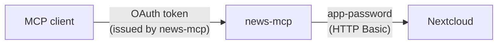
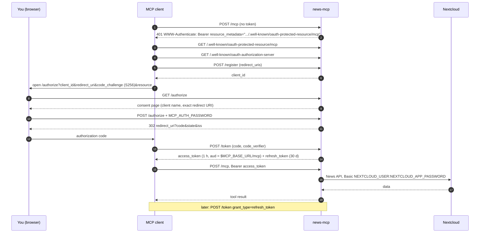

# Standalone mode

Standalone mode needs nothing but a Nextcloud account. news-mcp embeds a small OAuth 2.1 authorization server for MCP clients, and talks to Nextcloud with an app-password that never leaves the server.



## 1. Create a Nextcloud app-password

In Nextcloud: **Settings → Security → Devices & sessions → Create new app password**. Name it `news-mcp` and copy the generated password. You can revoke it there at any time.

## 2. Choose a server password

MCP clients get access through a browser page where you type a password. Pick a long one (at least 12 characters): it is the only thing protecting your account.

## 3. Run the server

### Locally

```sh
export NEXTCLOUD_URL=https://cloud.example.com
export NEXTCLOUD_USER=alice
export NEXTCLOUD_APP_PASSWORD='xxxxx-xxxxx-xxxxx-xxxxx-xxxxx'
export MCP_AUTH_PASSWORD='correct horse battery staple'
go run github.com/mrdev023/mcp-nextcloud-news@latest
```

The MCP endpoint is `http://localhost:8080/mcp`.

### With Docker Compose, behind HTTPS

```yaml
# compose.yaml
services:
  news-mcp:
    image: ghcr.io/mrdev023/mcp-nextcloud-news:latest
    restart: unless-stopped
    ports:
      - "127.0.0.1:8080:8080"   # only reachable through the reverse proxy
    environment:
      NEXTCLOUD_URL: https://cloud.example.com
      NEXTCLOUD_USER: alice
      NEXTCLOUD_APP_PASSWORD: ${NEXTCLOUD_APP_PASSWORD}
      MCP_AUTH_PASSWORD: ${MCP_AUTH_PASSWORD}
      MCP_BASE_URL: https://news.example.com   # public URL, used in OAuth metadata
```

Put the two secrets in a `.env` file next to `compose.yaml`, then run `docker compose up -d`.

Reverse proxy examples:

```caddy
# Caddyfile
news.example.com {
    reverse_proxy 127.0.0.1:8080 {
        flush_interval -1   # /mcp streams Server-Sent Events
    }
}
```

```nginx
# nginx
server {
    server_name news.example.com;
    listen 443 ssl;
    # ssl_certificate ...;

    location / {
        proxy_pass http://127.0.0.1:8080;
        proxy_set_header Host $host;
        proxy_http_version 1.1;
        proxy_buffering off;        # /mcp streams Server-Sent Events
        proxy_read_timeout 1h;
    }
}
```

If `MCP_BASE_URL` has a path (`https://example.com/news`), the proxy must keep that prefix. It must also route `/.well-known/oauth-authorization-server/news` and `/.well-known/oauth-protected-resource/news/mcp` from the domain root to news-mcp.

## 4. Connect a client

Clients discover everything from the endpoint URL: they get a `401`, read the metadata, register themselves, then open the authorization page in your browser. Type `MCP_AUTH_PASSWORD` there and approve.

**Claude Code**

```sh
claude mcp add --transport http nextcloud-news https://news.example.com/mcp
```

Then run `/mcp`, select `nextcloud-news` and choose *Authenticate*.

**Claude Desktop / claude.ai**

Go to *Settings → Connectors → Add custom connector* and enter `https://news.example.com/mcp`.

**Cursor** (`~/.cursor/mcp.json`)

```json
{ "mcpServers": { "nextcloud-news": { "url": "https://news.example.com/mcp" } } }
```

### Pre-registered client (optional)

Clients register themselves through dynamic client registration by default. To allow only one known client instead:

```sh
MCP_OAUTH_DCR=false
MCP_OAUTH_CLIENT_ID=my-client
MCP_OAUTH_CLIENT_SECRET=...            # omit for a public client
MCP_OAUTH_REDIRECT_URIS=https://claude.ai/api/mcp/auth_callback
```

Enter the client id and secret in the client's advanced connector settings.

## How the authorization flow works

On first connection, the client discovers news-mcp's authorization server and runs a standard OAuth 2.1 flow. You approve it once in your browser.



What the embedded authorization server implements, following the [MCP authorization spec](https://modelcontextprotocol.io/specification/latest/basic/authorization) (revision 2026-07-28):

- **Discovery.** Protected Resource Metadata ([RFC 9728](https://datatracker.ietf.org/doc/html/rfc9728)) and Authorization Server Metadata ([RFC 8414](https://datatracker.ietf.org/doc/html/rfc8414)).
- **Authorization Code with PKCE.** Only `S256` is accepted. Authorization responses carry `iss` ([RFC 9207](https://datatracker.ietf.org/doc/html/rfc9207)), and refresh tokens are issued.
- **Audience-bound tokens.** Tokens are bound to `$MCP_BASE_URL/mcp` through resource indicators ([RFC 8707](https://www.rfc-editor.org/rfc/rfc8707.html)). `/mcp` rejects any other token and never forwards one.
- **Client registration.**
  - Dynamic client registration ([RFC 7591](https://datatracker.ietf.org/doc/html/rfc7591)) is kept because current MCP clients rely on it, although the spec deprecates it in favour of Client ID Metadata Documents, which are not implemented.
  - A single pre-registered client is also supported (see below).
- **Consent page.** It shows the client name and the exact redirect URI, and warns on loopback redirects. It cannot be framed.

## Security notes

- **Token lifetimes.** Access tokens last 1 hour and refresh tokens 30 days. Authorization codes are single-use and expire after 5 minutes.
- **Survive restarts.** Tokens are signed, not stored, so they remain valid after a restart.
- **Revoke everything.** Change `MCP_AUTH_PASSWORD`, or set a new `MCP_OAUTH_SIGNING_KEY`.
- **Lockout.** The authorization page locks after 10 failed attempts within 15 minutes.
- **HTTPS.** Only expose the server over HTTPS.
